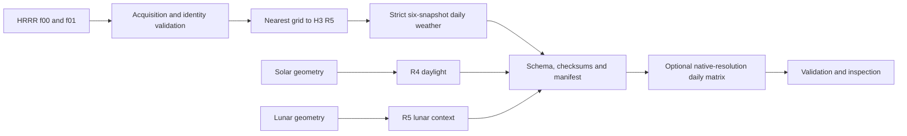

# Reproducible context for environmental modeling

`toolkit-meteorology` retrieves selected weather variables through Python getters
and the `meteorology get` command. Choose HRRR or ERA5 explicitly, preview a bounded
request, then retain daily or hourly data with units, coverage, nulls and
checksum-backed source lineage. The package also builds independently versioned
weather, daylight and lunar families.

Start with the [quickstart](getting-started/quickstart.md) and
[weather request guide](request-api.md). Python 3.11–3.13 on macOS/Linux is supported.
The [Python API](reference/api.md) and [CLI reference](reference/cli.md) document
both selective requests and existing family workflows.

For multi-year historical meteorology, use the
[ERA5 backfill API and CLI](era5-backfill.md). It plans monthly regional jobs,
resumes valid completed work and writes daily native-grid or optional sampled
R5 features. See the [measured performance and remaining qualification gates](era5-backfill-performance.md).

<div class="grid cards" markdown>

- :material-weather-partly-cloudy: **Selective weather**<br>
  Request only supported quantities. HRRR offers R5 or native support; ERA5 retains its native distribution grid.

- :material-clock-outline: **Daily and hourly results**<br>
  Actual UTC samples, complete-day reductions, explicit missingness and disk-backed exports with reusable caches.

- :material-weather-sunny: **Daylight**<br>
  Deterministic solar context at R4, including a compact 365/366-day lookup and explicit polar missingness.

- :material-moon-waning-crescent: **Lunar context**<br>
  Approximate phase, illumination and geometrical moon visibility at R5. Actual surface illumination is outside the method.

- :material-file-check-outline: **Validated releases**<br>
  Checksummed tables and manifests identify software, method, execution and content release independently.

</div>

## Preview a request

```bash
python -m pip install '.[native-pilot]'  # from a clone, for selective HRRR
meteorology sources
meteorology variables --data-source hrrr
meteorology get temperature --start-date 2024-01-01 --end-date 2024-01-01 \
  --bbox -124 48 -123 48.5 --data-source hrrr --dry-run
```

The preview makes no provider requests or writes and requires no initialized
workspace. It reports dependencies, UTC boundaries, support, cache status and
resource caps. Replace `--dry-run` with `--cache-dir ./weather-cache --output
temperature.parquet` to acquire the selected fields and export the result.

```python
from meteorology import get_temperature

preview = get_temperature(
    "2024-01-01", "2024-01-01", (-124.0, 48.0, -123.0, 48.5), "hrrr",
    dry_run=True,
)
```

Without `dry_run=True`, a getter returns `WeatherResult`: `.to_pandas()` loads the
selected rows and `.to_parquet(path)` streams an export with durable metadata.
Dates are inclusive UTC days. Source support and accumulation rules are detailed
in the [request guide](request-api.md).

## Try the software offline

From a clone, the request demo uses generated ERA5 GRIB through the public getter:

```bash
python -m pip install '.[era5]'
python demo/request_offline.py --output ./request-demo
```

For a core-only installed-package example, use a fresh workspace:

```bash
meteorology --workspace ./weather-demo init
meteorology --workspace ./weather-demo example-offline
meteorology --workspace ./weather-demo validate \
  --daily-matrix ./weather-demo/outputs/synthetic-daily-matrix.parquet
```

Both examples label their inputs **synthetic** and make no provider requests.
Generated-GRIB and mocked-HTTP checks establish software behavior; new live
NOAA/CDS query compatibility and independent regional accuracy remain unverified
in this refactor. See the [implementation tracker](IMPLEMENTATION_TRACKER.md) and
[measured refactor evidence](request-refactor-evidence.md).

## One week of real weather

The [live one-week demo](live-week-demo.md) builds hourly H3 releases and compact
daily/weekly H3 and regional summaries, with explicit transfer budgets, resumption
and resource accounting. Observational accuracy and future forecast skill remain
separate acceptance gates.

## Existing family products

The original daily weather family uses six local-day HRRR `sfc/f00` analyses and
matched `sfc/f01` precipitation-rate forecasts. `PRECIP_MM_DAY_ESTIMATE` remains an
estimate from six snapshots, separate from the selective ERA5 hourly accumulation
totals. The [hourly H3 family](hourly-weather.md) retains distinct f00 values at
each actual UTC hour. These family workflows preserve their original local-day,
DST, method and release contracts.



Solar and lunar products require H3 support, but no HRRR acquisition. The optional daily matrix retains R4 and R5 rows separately; unsupported component columns remain null.

Weather, daylight and lunar context do not measure species occurrence, observer access, reporting, or detection probability. Read the [scientific methodology](methodology.md) and [limitations](limitations.md) before using these values as predictors.

Use [shared-study configuration](shared-study.md) and
[marine reporting integration](marine-reporting.md) for production study outputs;
their geometry, registry and publication gates remain separate from a bbox query.
