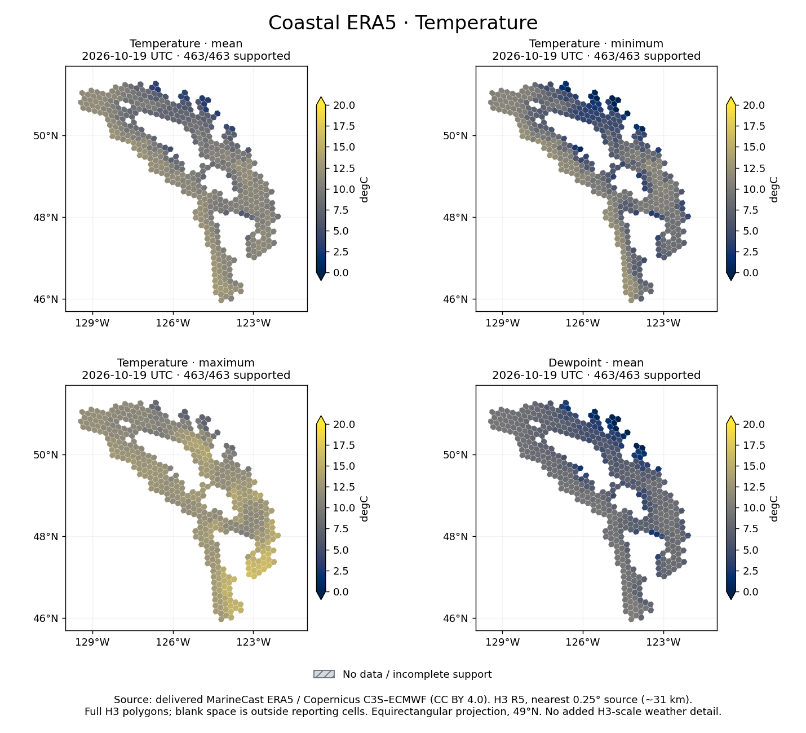
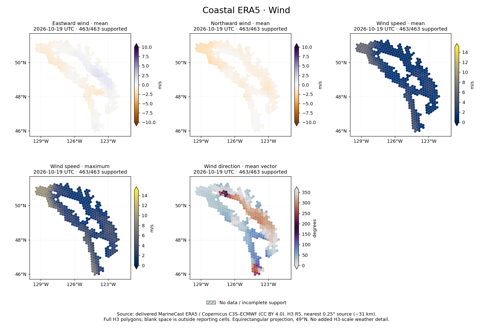
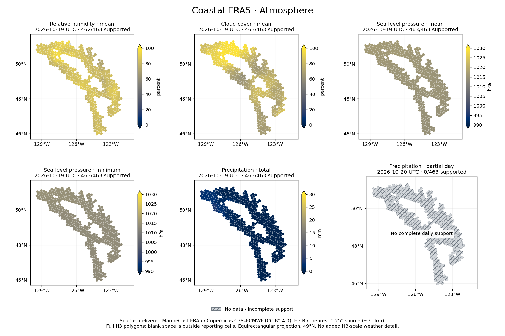

# Reproducibility review · 2026-10-29

**Verified:** a wheel built from the current working tree reproduced October 19–20,
2026 using the retained October 26 source snapshot, with zero provider requests.
Every key, value and null matched the delivered product exactly: 926 daily rows
(14 metrics) and 22,224 hourly rows (10 metrics), across all 463 approved cells.
This is two-day numerical replay, **not full historical reconstruction** or
byte-identical reproduction of the full Parquet files.

The installed public `get_weather` API and `check_weather` validator were used
outside the checkout. A one-byte transfer cap made missing cached objects fail
before download. The current working tree includes pre-existing, uncommitted
frontier-refresh code; the review does not imply that Git HEAD alone includes it.
Evidence records code hashes, package/environment and the product identity.

## Delivered inventory and prerequisites

| Item | Observed state |
| --- | --- |
| Canonical product | `Data/Meteorology/catalog.json`, `meteorology-daily.parquet`, `meteorology-hourly.parquet` |
| Inclusive coverage | 2009-01-01–2026-10-20; UTC |
| Daily / hourly rows | 3,010,426 / 72,250,224 |
| Last complete all-metric day | 2026-10-19 |
| Partial day | October 20: 23/24 precipitation intervals; 463 daily nulls and 463 missing final hourly values |
| Earlier endpoint | October 10 precipitation repaired with retained 23 hours plus the newly supported next-midnight interval |
| Recent source cache | `.marinecast-work/meteorology/frontier-20261026` (about 669 MiB), outside delivery |
| Historical source payloads | Original pre-refresh vintages deleted under the earlier retention policy; receipts/hashes remain |
| HRRR | No HRRR-named files found in the delivered `Data` inventory; no supported HRRR producer in this package |

External prerequisites are the approved `config/study.v1.json` and the exact
registry manifest, reporting mask and membership files it references. They are not
bundled in the wheel. Python 3.11–3.13 and the runtime dependencies in
`pyproject.toml` are required; this review ran Python 3.12. The daily schema is
`H3_INDEX`, `DATE`, and 14 numeric fields; hourly uses `H3_INDEX`, UTC `DATETIME`,
and 10 numeric fields. The catalog supplies units, schemas, hashes and provenance.
See [the API contract](regional-api.md) for the complete field list.

Instantaneous daily fields use 00–23 UTC. Hourly precipitation is labelled by
interval start, while its source validity time is the following hour. Daily
precipitation uses intervals ending 01:00 through next midnight. Missing or
unsupported RH stays null; wind direction comes from mean vector components.
Quarter-degree nearest sampling supplies about 31 km atmospheric information,
not independent H3 R5 detail. These are retrospective reanalysis products, not
issue-time-qualified forecasts.

## Repeat the bounded replay

Build and install the current source into an existing suitable environment:

```sh
python -m build --no-isolation --outdir /tmp/meteorology-review-dist
python -m pip install --no-deps --target /tmp/meteorology-review-installed /tmp/meteorology-review-dist/*.whl
```

Run outside the checkout with the installed package ahead of any editable install.
Use a new scratch destination. The example copies the retained cache with an APFS
copy-on-write clone on macOS; on other systems it makes a bounded ordinary copy
and needs roughly 700 MiB additional disk space. It does not mutate the retained
source or delivery directory. The production API cleans its owned transient clone
only after successful readback.

```sh
cd /tmp
PYTHONPATH=/tmp/meteorology-review-installed python /path/to/toolkit-meteorology/docs/examples/replay_retained.py \
  --workspace /path/to/MarineCast \
  --work /tmp/meteorology-replay-new
```

The script deliberately selects the verified recent dates and pinned cache. It
writes `replay-evidence.json` and a two-day scratch product. Failure on an absent
cache is a prerequisite failure; do not replace it with unqualified fresh downloads.
A fresh source vintage can revise historical values. There is no supported public
cache-seeding switch: this audit example explicitly prepares an owned scratch cache
using the internal `source_root` layout and ownership marker. Treat that adapter as
version-specific, not a new public API.

For a fresh ordinary production run, the supported API is:

```python
from meteorology import ALLOWED_VARIABLES, get_weather
result = get_weather(
    '2026-10-19', '2026-10-20', ALLOWED_VARIABLES,
    study_config='/path/to/MarineCast/config/study.v1.json',
    output_dir='/tmp/weather-fresh', cache_dir='/tmp/weather-work',
    allow_incomplete_final_day=True, verbosity=False, rebuild=False,
)
```

That command can acquire data and is **not** the offline review command. CLI runs
require all six effective settings (dates, output, metrics, verbosity, rebuild);
run outside a personal `.env` or provide an explicit reviewed settings file.

## Example maps

The [map example](examples/example_maps.py) reads only selected delivered days;
it does not contact a provider or change data. Matplotlib is an optional
documentation dependency, not a runtime dependency or restored visualization API.

```sh
python -m pip install matplotlib
python docs/examples/example_maps.py \
  --data-dir /path/to/MarineCast/Data/Meteorology \
  --output-dir /tmp/weather-maps \
  --date 2026-10-19 --partial-date 2026-10-20
```

All 14 daily layers are represented below, plus the partial-day precipitation
case. Comparable fields share scales; color-bar triangles identify overflow.
Direction is meteorological degrees **from**, clockwise from north (0/360 north,
90 east, 180 south, 270 west). The figures show full H3 polygons, not clipped water
coverage, using a spherical equirectangular projection with standard parallel
49°N. Blank areas are outside reporting membership; gray hatching means missing
or incomplete support. One RH cell is unsupported on October 19; October 20's
daily precipitation is entirely null, not zero rainfall. Figures were rendered
and visually inspected at export size; open the full image to inspect small panels.







[Map statistics](assets/review-20261029/map-statistics.json) retain the plotted
row counts, null counts and extrema. Source: delivered MarineCast product,
Copernicus Climate Change Service / ECMWF ERA5, CC BY 4.0.

## Verification and remaining gaps

Current review: 143 source tests and 143 outside-checkout installed-wheel tests
passed; lint, strict docs, wheel/sdist build, Twine metadata validation, dependency
check and CLI smoke passed. The read-only installed CLI validated the full current
catalog/products against the approved study. See
[review evidence](evidence/review-20261029.json) for exact hashes and scope.
The prior dated acceptance counts elsewhere are historical evidence only.

The top-level catalog says `payloads_retained: true` and
`rebuild_requires_acquisition: false`; those flags describe the recent caller-owned
refresh cache, not all historical epochs. Older `source_epochs` explicitly mark
payloads unretained. Do not infer full reconstructability from the top-level flag.
A portable multi-epoch replay descriptor and historical payloads would be needed
to demonstrate full reconstruction. This review does not establish observational
accuracy, historical availability, fresh-provider equality or other Python versions.
No full history collection or rebuild was performed.
